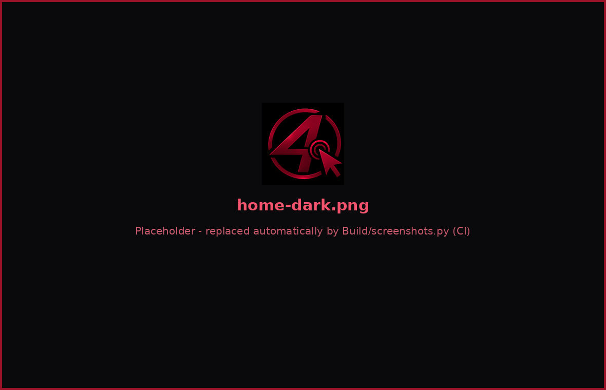
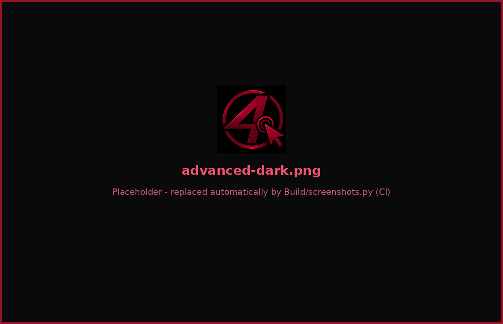
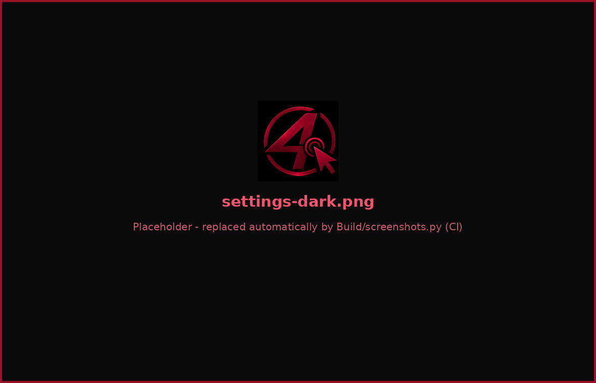
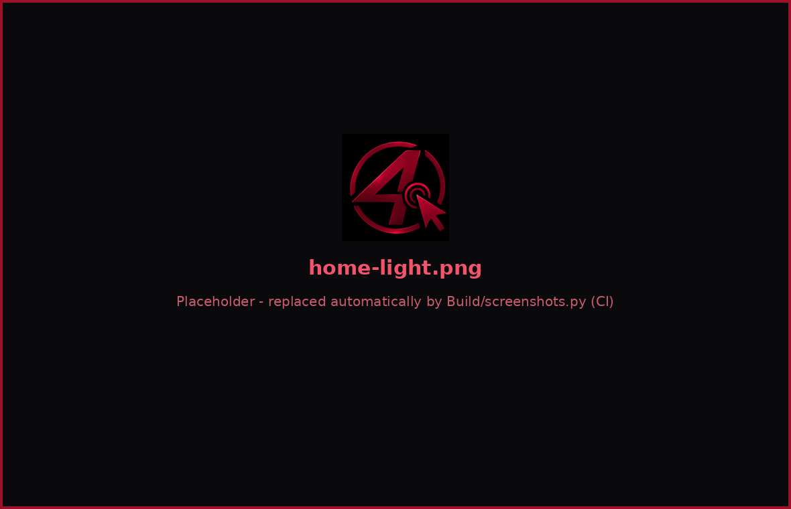
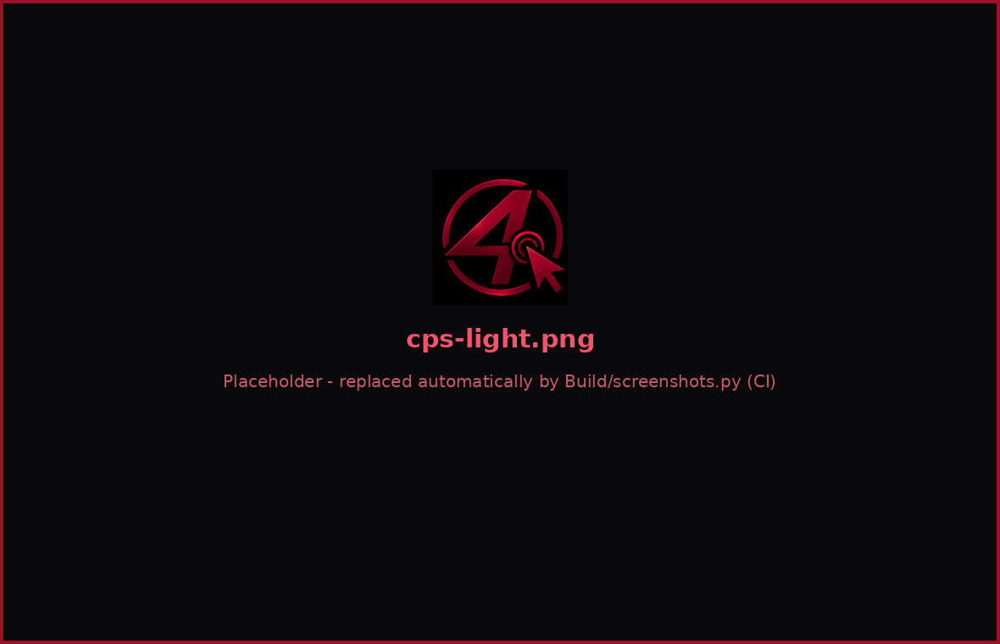

<div align="center">


# 4R022 AutoClicker

**Professional AutoClick Application** · `1.0V Beta`

[](.github/workflows/ci.yml)
[](#-platform-desteği)
[](#-diller)
[](LICENSE)

🇹🇷 **Türkçe** · [🇬🇧 English](README.en.md)

*Hassas zamanlama · Çoklu hedef · KillSwitch güvenliği · CPS testi · Bordo/Siyah 4R022 arayüzü*

</div>

---

## 📸 Ekran Görüntüleri

> Görseller `Build/screenshots.py` ile **otomatik** üretilir (CI her `main` push'unda yeniler).

<div align="center">

| Ana Sayfa (koyu · bordo) | CPS Testi |
|:---:|:---:|
|  |  |
| **Gelişmiş Ayarlar** | **İstatistikler** |
|  |  |
| **Günlükler & Tanılama** | **Ayarlar** |
|  |  |
| **Beyaz Tema – Ana Sayfa** | **Beyaz Tema – CPS** |
|  |  |

</div>

---

## ✨ Öne Çıkan Özellikler

| | |
|---|---|
| 🖱️ **Tıklama motoru** | Sol / sağ / orta tuş · tek, çift ve otomatik seri tıklama · saat-dakika-saniye-milisaniye aralığı |
| 🎯 **Hedefleme** | Mevcut konum, sabit nokta (X/Y) veya **çoklu hedef listesi** (sırayla · rastgele · ileri-geri) |
| ⏱️ **Hassas zamanlama** | Kaymasız (drift-free) zamanlayıcı: kaba bekleme + son milisaniyelerde hassas bekleme |
| 🎲 **Rastgelelik** | Min–Max rastgele aralık, konum sapması (jitter), basılı tutma süresi |
| 🔁 **Döngü sistemi** | Belirli sayıda döngü, tıklama sayısı limiti, başlangıç gecikmesi, azami çalışma süresi |
| ⏯️ **Duraklat / Devam** | Sayaçları sıfırlamadan duraklatma; duraklama süresi istatistiklere yansımaz |
| 🛑 **KillSwitch** | Kısayol + büyük kırmızı buton + köşe güvenliği + otomatik kapatma + watchdog (takılı fare tuşunu serbest bırakır) |
| ⌨️ **Kısayollar** | **Her tuş** (ve Ctrl/Shift/Alt kombinasyonları) herhangi bir eyleme atanabilir — varsayılan: F6 başlat, F7 durdur, F8 duraklat, F9 hedef ekle |
| 📊 **İstatistik** | Toplam tıklama, geçen süre, ortalama / anlık / tepe CPS, oturum geçmişi, canlı grafik |
| 🧾 **Günlükler** | Profesyonel görev takip günlüğü (filtreli), hata günlüğü, tanılama ekranı |
| 📤 **Dışa aktarma** | TXT · JSON · CSV (Excel uyumlu) — klasörü uygulamadan seç ve aç |
| 🔐 **Giriş-çıkış takibi** | Uygulama açılış/kapanış ve oturum başlangıç/bitiş kayıtları |
| ⚡ **CPS Testi** | 15 / 30 / 60 sn testleri, canlı sayaç, saniye grafiği, tutarlılık, rekorlar, seviye sistemi |
| 🧩 **Eklentiler** | Olay tabanlı Python eklenti sistemi (başlat/durdur/duraklat/devam/oturum) |
| 🌍 **3 dil** | Türkçe · English · Русский — **yeniden başlatmadan** değişir |
| 🎨 **2 tema** | Koyu (siyah + bordo yazılar, 4R022'ye özel) ve Beyaz |
| 🫥 **Arka plan** | Sistem tepsisinde çalışmaya devam eder, sağ tık menüsü: Ana Sayfa / CPS / Ayarlar / Başlat-Durdur / KillSwitch |
| 🛡️ **Tuş koruması** | Arka plandayken yanlışlıkla tetiklemeyi önleyen çift basış koruması |
| ♿ **Erişilebilirlik** | Tam klavye gezintisi (Ctrl+1…7), yazı boyutu %80–160, ekran okuyucu adları, yüksek kontrastlı bordo palet |

---

## 🏗️ Mimari: Core + Worker

```
Main/
├── main.py                      ← giriş noktası (--selftest, --version, --minimized)
├── autoclicker/
│   ├── core/                    ← GUI'den bağımsız çekirdek (tamamen test edilir)
│   │   ├── engine.py            ← ClickEngine: yaşam döngüsü, oturum kayıtları, olaylar
│   │   ├── workers.py           ← ClickWorker (hassas tıklama iş parçacığı) + TaskPool (genel amaçlı Worker havuzu)
│   │   ├── backend.py           ← Win32 → pynput → pyautogui yedek zinciri (+ Dummy test motoru)
│   │   ├── hotkeys.py           ← Genel kısayollar, kombinasyon eşleştirici, tuş koruması
│   │   ├── killswitch.py        ← Acil durdurma + watchdog + otomatik kapatma
│   │   ├── cps_test.py          ← CPS test mantığı ve istatistikleri
│   │   ├── session.py           ← Oturum / etkinlik / CPS depoları (JSONL)
│   │   ├── exporter.py          ← TXT · JSON · CSV dışa aktarma
│   │   ├── plugins.py           ← Eklenti yöneticisi
│   │   └── config.py            ← Ayar modeli (atomik yazma, bozulmaya dayanıklı)
│   ├── i18n/                    ← tr.json · en.json · ru.json
│   ├── ui/                      ← PySide6 arayüzü (7 sayfa, tema, tepsi, mini panel)
│   └── plugins_examples/        ← Örnek eklentiler
├── tests/                       ← 38 birim testi
Build/
├── build.py                     ← Otomatik, gösterişli build sistemi
├── screenshots.py               ← README ekran görüntülerini üretir
└── 4R022-AutoClicker.spec       ← PyInstaller tanımı
```

**Neden Core + Worker?**

* **Core** hiçbir GUI kütüphanesini içe aktarmaz; böylece motor, kısayollar ve istatistikler başsız (headless) test edilebilir.
* **ClickWorker** tıklamaları kendi iş parçacığında yapar. Arayüz yalnızca 10 Hz'de bir anlık görüntü (snapshot) okur — tıklama başına sinyal yoktur, bu yüzden yüksek CPS'de arayüz yavaşlamaz.
* **TaskPool** dışa aktarma gibi gerçek zamanlı olmayan işleri arka planda yürütür; tıklama zamanlamasını asla bloklamaz.
* **Güvenlik kritik** eylemler (Durdur, KillSwitch) kısayol dinleyicisinin iş parçacığında doğrudan çalışır; arayüz meşgul olsa bile acil durdurma çalışır.

---

## 🖥️ Platform Desteği

| Platform | Motor | Notlar |
|---|---|---|
| **Windows 10/11** | `win32` (varsayılan) → `pynput` | Yönetici yetkisi gerekmez; yönetici olarak çalışan uygulamalara tıklamak için AutoClicker'ı da yönetici çalıştırın |
| **macOS 12+** | `pynput` | **Sistem Ayarları → Gizlilik ve Güvenlik** bölümünde *Erişilebilirlik* ve *Girdi İzleme* izni verin |
| **Linux (X11)** | `pynput` | Tam destek. **Wayland** oturumlarında genel kısayol/tıklama kısıtlıdır — X11 oturumu önerilir |

Ayarlardan motor elle seçilebilir; hiçbiri bulunamazsa uygulama çökmez, güvenli bir *boş* motora düşer ve Tanılama sayfası nedenini gösterir.

---

## 🚀 Kurulum ve Çalıştırma

### Hazır sürüm
[Releases](../../releases) sayfasından platformunuza uygun paketi indirin, açın, çalıştırın. Her pakette `SHA256SUMS.txt` bulunur.

### Kaynaktan
```bash
git clone https://github.com/<kullanici>/4R022-AutoClicker.git
cd 4R022-AutoClicker
python -m venv .venv && source .venv/bin/activate     # Windows: .venv\Scripts\activate
pip install -r requirements.txt
python Main/main.py
```

Komut satırı seçenekleri:

| Seçenek | Açıklama |
|---|---|
| `--minimized` | Doğrudan sistem tepsisine küçültülmüş başlar |
| `--selftest` | Başsız kendi kendine test (motor, dil dosyaları, dışa aktarma …) |
| `--selftest-gui` | Ek olarak tüm sayfaları 3 dil × 2 temada ekran dışı çizer |
| `--version` | Sürümü yazdırır |

---

## ⌨️ Varsayılan Kısayollar

| Eylem | Tuş | Not |
|---|---|---|
| Başlat | `F6` | Her tuşa atanabilir |
| Durdur | `F7` | Tuş korumasından etkilenmez |
| Duraklat / Devam | `F8` | |
| Hedef ekle | `F9` | İmlecin bulunduğu noktayı hedef listesine ekler |
| **KillSwitch** | `Ctrl+Shift+F12` | Her şeyi anında durdurur, fare tuşlarını serbest bırakır |
| Sayfalar | `Ctrl+1 … Ctrl+7` | Klavyeyle sayfa geçişi |

Kısayol atamak için Ana Sayfa → *Kısayol tuşları* kartında ilgili düğmeye tıklayın ve istediğiniz tuşa basın. Çakışmalar otomatik reddedilir.

---

## 🛑 KillSwitch & Güvenlik Katmanları

1. **Kısayol** (`Ctrl+Shift+F12`) ve **kırmızı ACİL DURDUR düğmesi**
2. **Köşe güvenliği** — imleci ekranın sol üst köşesine götürmek işlemi durdurur
3. **Otomatik kapatma** — belirli dakika kesintisiz çalışmadan sonra durdurur (isteğe bağlı olarak uygulamadan da çıkar)
4. **Azami çalışma süresi** ve **tıklama / döngü limitleri**
5. **Watchdog** — tıklama iş parçacığı yanıt vermezse tüm fare tuşlarını serbest bırakır
6. **Hata eşiği** — üst üste 5 tıklama hatasında motor kendini durdurur
7. **Tuş koruması** — arka plandayken Başlat/Duraklat/Hedef-ekle çift basış ister

> ⚠️ Bu yazılım yalnızca **kendi bilgisayarınızda, izin verilen kullanımlar** (test, erişilebilirlik, otomasyon) içindir. Hizmet şartlarını ihlal eden, haksız avantaj sağlayan veya başkalarına zarar veren kullanımlardan kullanıcı sorumludur.

---

## ⚡ CPS Testi

* Süre seçin: **15 / 30 / 60 saniye** — **ilk tıklama** testi başlatır.
* Fare tuşlarından herhangi biri ya da `Boşluk`/`Enter` ile tıklayabilirsiniz (tıklama *basış anında* sayılır).
* Canlı sayaç, kalan süre, anlık CPS ve **saniye başına tıklama grafiği**.
* Sonuç: toplam tıklama, ortalama CPS, **tepe CPS (en iyi 1 sn)**, skor, **tutarlılık %**, ortalama/en hızlı/en yavaş tıklama aralığı, ilk yarı–ikinci yarı CPS (yorulma analizi), **seviye** (Çaylak → Efsane) ve **kişisel rekor** bildirimi.
* Geçmiş tabloya kaydedilir; TXT / JSON / CSV olarak dışa aktarılabilir.

---

## 🧩 Eklenti Yazma

`plugins` klasörüne tek bir `.py` dosyası bırakın (klasörü *Eklentiler* sayfasından açabilirsiniz):

```python
PLUGIN_INFO = {"name": "Merhaba", "version": "1.0", "author": "Ben", "description": "Her oturumu kaydeder"}

def register(api):
    def bitti(kayit):                       # kayit: toplam tıklama, ort. CPS, bitiş nedeni ...
        api.log(f"{kayit['total_clicks']} tıklama yapıldı")
    api.on("session", bitti)                # olaylar: start · stop · pause · resume · session
```

Eklentiler **varsayılan olarak kapalıdır** ve tam Python yetkisiyle çalışır — yalnızca güvendiğiniz kodu etkinleştirin. Hatalı bir eklenti uygulamayı çökertmez; hata günlüğe yazılır.

---

## 📁 Veri Konumları

| Platform | Yol |
|---|---|
| Windows | `%APPDATA%\4R022-AutoClicker` |
| macOS | `~/Library/Application Support/4R022-AutoClicker` |
| Linux | `~/.local/share/4R022-AutoClicker` |

İçerik: `config.json`, `sessions.jsonl`, `activity.jsonl`, `cps_results.json`, `logs/`, `plugins/`. Dışa aktarma klasörü varsayılan olarak `Documents/4R022-AutoClicker-Exports`'tur ve Ayarlar'dan değiştirilebilir. Taşınabilir kullanım için `AUTOCLICKER_4R022_HOME` ortam değişkeni ile veri klasörü yönlendirilebilir.

---

## 🤖 Otomatik Build Sistemi

```bash
python Build/build.py                # tam hat
python Build/build.py --dry-run      # PyInstaller hariç tüm denetimler (hızlı)
python Build/build.py --onedir       # tek dosya yerine klasör
```

**Hat:** ortam denetimi → birim testleri → kaynak self-test (GUI dahil) → varlık/dil doğrulaması → **PyInstaller** → **derlenmiş uygulamayı `--selftest-gui` ile doğrulama** → paketleme (`.zip` / `.tar.gz`) → SHA-256 → `BUILD_REPORT.md` + `build-info.json`.

Herhangi bir adım başarısız olursa build **durur ve sürüm üretilmez** — bozuk bir uygulama yayınlanamaz.

**GitHub Actions**

| İş akışı | Tetikleyici | Ne yapar |
|---|---|---|
| `ci.yml` | push / PR | 3 işletim sisteminde test + GUI self-test + build dry-run; `main`'de README ekran görüntülerini yeniler |
| `build.yml` | `v*` etiketi / elle | Windows + macOS + Linux paketlerini derler, doğrular, **Release** yayınlar (`1.0.0b1` gibi `b` içeren etiketler *pre-release* olur) |

Sürüm çıkarmak için:
```bash
git tag v1.0.0b1 && git push origin v1.0.0b1
```

---

## 🧪 Testler

```bash
cd Main
python -m unittest discover -s tests -t . -v
```

Kapsam: motor (tıklama sayıları, çift/seri, döngü, çoklu hedef sırası, duraklat/devam, başlangıç gecikmesi, rastgele aralık, köşe güvenliği, azami süre, hata eşiği), kısayol eşleştirici (kombinasyonlar, tuş tekrarı, tuş koruması, yakalama), CPS istatistikleri, ayar doğrulama/bozuk dosya, dışa aktarma, eklentiler ve **TR/EN/RU çeviri bütünlüğü** (kodda kullanılan her anahtarın üç dilde var olduğu doğrulanır).

---

## 🗺️ Yol Haritası

* [ ] Kaydet-oynat (makro) modu
* [ ] Görüntü/renk tabanlı hedef bulma
* [ ] Profil sistemi (birden fazla ayar seti)
* [ ] Daha fazla dil

---

<div align="center">

**4R022** · Professional AutoClick Application · `1.0V Beta`

</div>
